### Figura 01: Crescimento Absoluto (Clientes vs. Chamados)
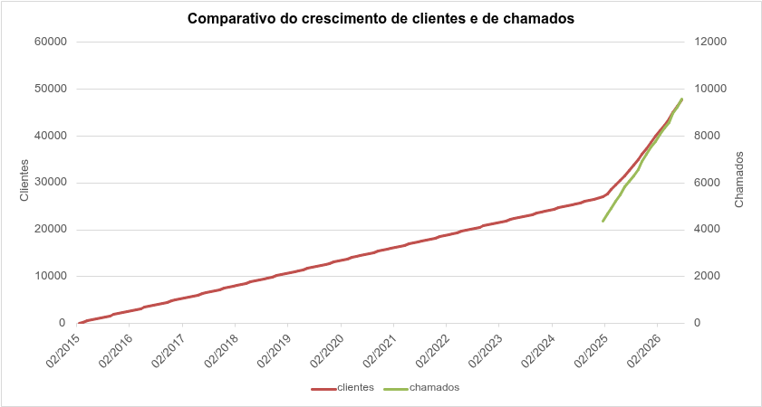

*   **O que mostra:** A evolução do volume absoluto de clientes e de chamados ao longo do tempo.
*   **Análise:**
    *   A base de clientes apresentou um crescimento linear contínuo até 2024, com um aumento acentuado a partir de 2025.
    *   A base de chamados inicia em 2025 (início da série histórica) e acompanha a tendência de alta da base de clientes.
    *   **Insight:** O volume absoluto de chamados cresce junto com a base. A análise isolada deste gráfico não permite avaliar a eficiência operacional ou a qualidade do produto, pois ambas as variáveis crescem juntas.

### Figura 02: Taxa de Acionamento (Chamados por Cliente)
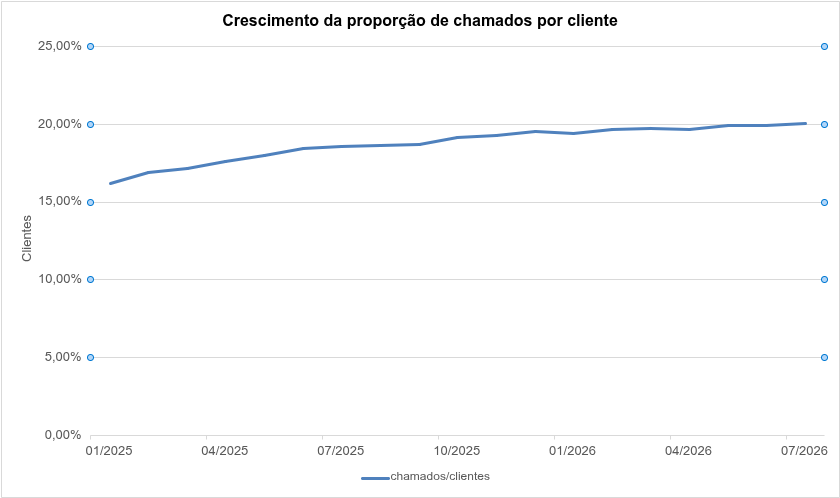

*   **O que mostra:** A proporção de chamados abertos em relação ao tamanho da base de clientes.
*   **Análise:**
    *   A taxa de acionamento (chamados por cliente) subiu de **16,1%** (jan/2025) para **20,0%** (jul/2026).
    *   **Insight:** O aumento no volume de chamados não é explicado apenas pelo crescimento da base. Há um aumento na incidência de chamados por cliente, indicando uma piora na experiência ou na estabilidade do produto.

### Figura 03: Volume Absoluto e Participação de "Problema com Aplicativo"
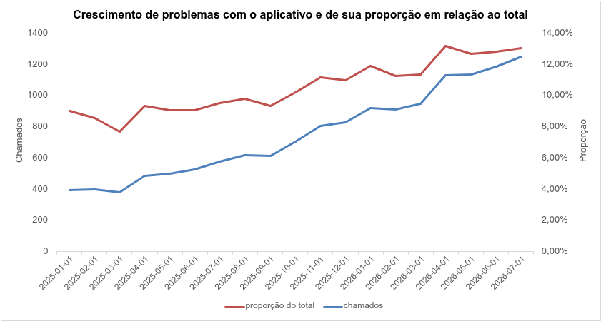

*   **O que mostra:** A evolução do volume de chamados por falhas no aplicativo e a sua proporção em relação ao total de chamados do mês.
*   **Análise:**
    *   O volume absoluto cresceu de aproximadamente 400 chamados/mês (início de 2025) para mais de 1.200 chamados/mês (julho de 2026).
    *   A proporção em relação ao total também cresceu, passando de cerca de 9% para 13%. O formato da curva de proporção acompanha a variação mensal do volume absoluto.
    *   **Insight:** O "problema com aplicativo" aumentou tanto em volume quanto em representatividade no total. A variação mensal deste motivo é o principal direcionador das variações do volume total de chamados.

### Figura 04: Custo Médio por Canal e Status de Resolução
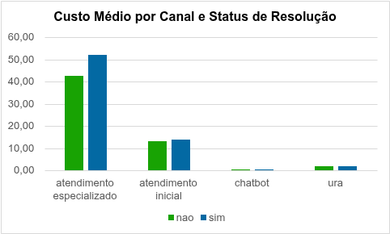

*   **O que mostra:** O custo médio por chamado, segmentado por canal e separando os chamados resolvidos dos não resolvidos.
*   **Análise:**
    *   O atendimento especializado possui o maior custo médio (superior a R$ 50,00), enquanto o atendimento inicial custa cerca de R$ 14,00 e o autosserviço menos de R$ 3,00.
    *   Em todos os canais, chamados resolvidos apresentam um custo médio superior aos não resolvidos, o que é esperado, pois a resolução demanda mais tempo de atendimento.
    *   **Insight:** A principal alavanca de redução de custos é evitar o escalonamento para o Atendimento Especializado. Como o custo do N2 é cerca de 4 vezes maior que o N1 e mais de 15 vezes maior que o autosserviço, investir na resolução na primeira camada ou na automação gera uma economia significativa por chamado.

### Figura 05: Evolução do Custo Mensal - Problema com Aplicativo
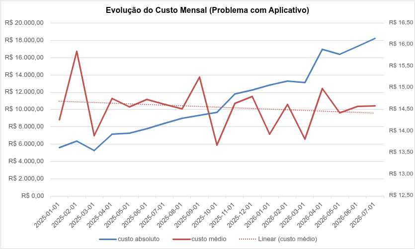

*   **O que mostra:** A evolução do custo total absoluto e do custo médio por chamado para o motivo "problema com aplicativo".
*   **Análise:**
    *   O custo absoluto (linha azul) apresentou um crescimento contínuo, passando de cerca de R$ 5.500 para mais de R$ 18.000 no final do período.
    *   O custo médio por chamado (linha vermelha) oscila, mas a linha de tendência (pontilhada) demonstra estabilidade, mantendo-se na faixa dos R$ 14,50 a R$ 15,00.
    *   **Insight:** O aumento do custo total não é resultado de uma perda de eficiência no atendimento, mas sim do crescimento do volume de falhas. A operação tem conseguido manter o custo unitário sob controle, mas o orçamento é fortemente impactado pela escala do problema no aplicativo.

### Figura 06: Média da Nota por Faixa de Tempo de Espera
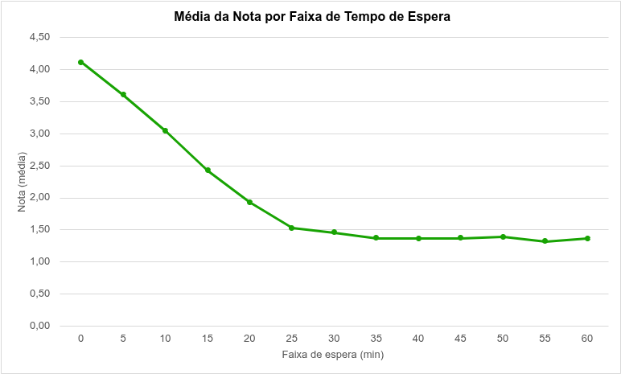

*   **O que mostra:** A relação entre o tempo de espera (em minutos) e a média das notas de satisfação atribuídas pelos clientes.
*   **Análise:**
    *   Chamados atendidos imediatamente (faixa de 0 a 5 minutos) apresentam as melhores médias de nota, acima de 3,6.
    *   A satisfação sofre uma queda linear e acentuada à medida que o tempo de espera aumenta. A nota média despenca de 4,1 (espera de 0 min) para aproximadamente 1,5 na faixa de 25 minutos.
    *   A partir de 25 minutos de espera, a nota se estabiliza em um patamar muito baixo (cerca de 1,4 a 1,5), indicando que a insatisfação já atingiu o seu limite máximo.
    *   **Insight:** O ponto crítico de ruptura da satisfação ocorre muito antes dos 25 minutos. Para manter uma experiência positiva (notas acima de 3,0), a espera precisa ser controlada em no máximo 10 a 15 minutos. Ultrapassar esse limite significa que o cliente já inicia o atendimento com um alto grau de frustração, tornando quase impossível reverter a avaliação negativa, independentemente da qualidade do atendimento posterior.

### Figura 07: Taxa de Resolução por Canal
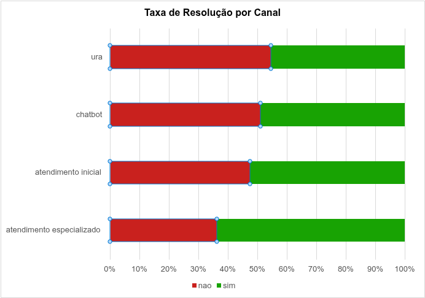

*   **O que mostra:** A proporção de chamados resolvidos (sim) e não resolvidos (não) em cada canal de atendimento.
*   **Análise:**
    *   O Atendimento Especializado (N2) detém a maior taxa de resolução da operação, atingindo cerca de 65%. No entanto, isso significa que 35% dos chamados que chegam à camada mais alta de suporte não são resolvidos.
    *   Os canais de autosserviço (URA e Chatbot) e o Atendimento Inicial (N1) apresentam taxas de resolução similares, variando entre ~46% e ~52%, deixando praticamente metade da demanda sem resolução.
    *   **Insight:** A operação possui um gargalo crítico de resolução definitiva. Se nem a camada mais especializada e cara consegue resolver mais de dois terços dos chamados que recebe, há uma deficiência estrutural (seja por falta de ferramentas/autonomia do atendente, ou por problemas que dependem de correção de engenharia, como as falhas do aplicativo). Além disso, o alto índice de não resolução nas camadas iniciais gera um transbordamento inevitável para o N2, encarecendo o processo.

### Figura 08: Evolução do Volume de Abandonos por Canal
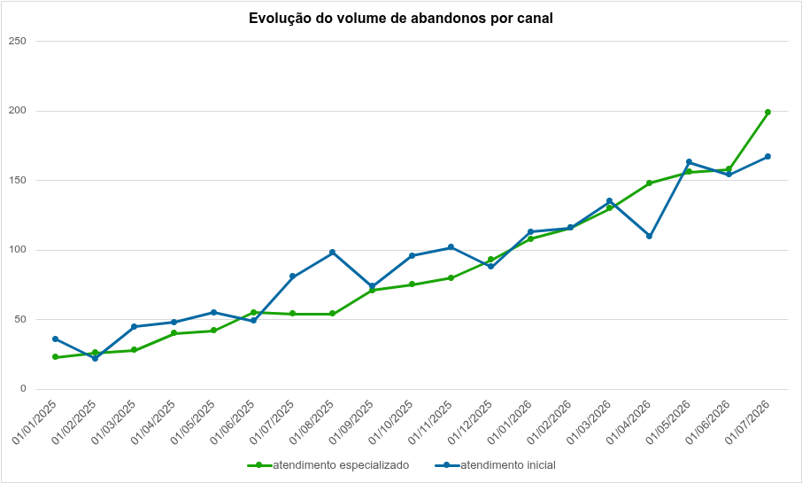

*   **O que mostra:** A evolução mensal do volume absoluto de abandonos nos canais de atendimento humano (Inicial e Especializado).
*   **Análise:**
    *   O volume de abandonos cresceu de forma consistente em ambos os canais ao longo do período, passando de um patamar de 20 a 40 abandonos/mês no início de 2025 para mais de 160 a 200 abandonos/mês em julho de 2026.
    *   O Atendimento Especializado (N2) apresentou um ritmo de crescimento superior ao Atendimento Inicial (N1). Enquanto o N1 manteve o maior volume de abandonos no início da série, o N2 o ultrapassou a partir de meados de 2026, tornando-se o canal com maior número de desistências.
    *   **Insight:** O aumento das desistências acompanha a escalada do volume total de chamados. No entanto, a inversão observada no N2 revela um agravamento crítico: os clientes não estão desistindo apenas na triagem inicial, mas também na camada especializada. Isso indica que o tempo de espera para tratar os problemas mais complexos (como as falhas do aplicativo) tornou-se insustentável, fazendo o cliente desistir da resolução.

### Figura 09: Média da Nota por Faixa de Tempo de Atendimento
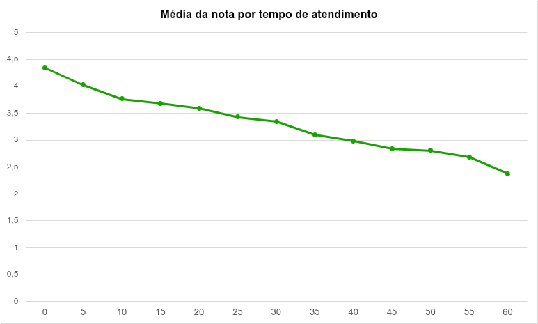

*   **O que mostra:** A relação entre o tempo de conversa/atendimento (em minutos) e a média das notas de satisfação atribuídas pelos clientes.
*   **Análise:**
    *   Atendimentos muito rápidos (0 a 5 minutos) concentram as notas mais altas, acima de 4,0.
    *   A satisfação cai de forma gradual e linear conforme o tempo de atendimento aumenta. A nota média leva cerca de 45 minutos para cair abaixo de 3,0.
    *   Comparado ao tempo de espera (Figura 06), o impacto do tempo de atendimento na nota é significativamente menor e mais suave. Não há um "ponto de ruptura" abrupto.
    *   **Insight:** O cliente tolera razoavelmente bem um atendimento longo, desde que esteja sendo efetivamente resolvido. O grande vilão da satisfação é a fila de espera, não a duração da conversa. Isso indica que as ações de melhoria devem priorizar a redução do tempo em fila (aumento do número de atendentes ou melhoria na triagem) em vez de focar exclusivamente em apressar os atendentes.
### Figura 10: Distribuição de criticidade por canal de atendimento
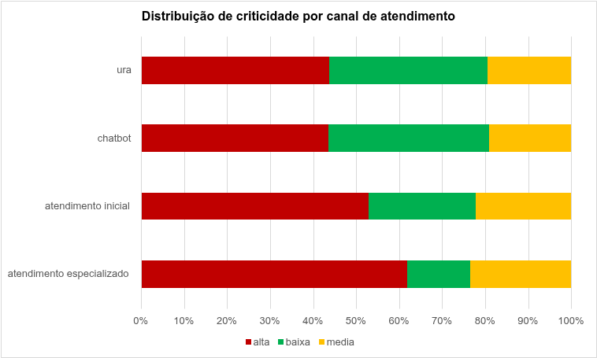

*   **O que mostra:** A proporção de chamados classificados como alta, média e baixa criticidade em cada canal.
*   **Análise:**
    *   A criticidade "alta" (vermelho) é dominante em todos os canais, representando mais de 40% do volume até mesmo na ura e no chatbot.
    *   O atendimento especializado concentra a maior proporção de chamados de alta criticidade (~62%), o que faz sentido por ser a última camada de suporte.
    *   **Insight:** A distribuição revela um possível erro de classificação ou de roteamento. Se problemas de alta criticidade (como cancelamento ou fraude) estão indo parar em canais de autosserviço, há um risco operacional grave. Por outro lado, se a automação resolve esses casos, a etiqueta "alta criticidade" está sendo aplicada a problemas simples.

### Figura 11: Distribuição dos motivos por canal de atendimento
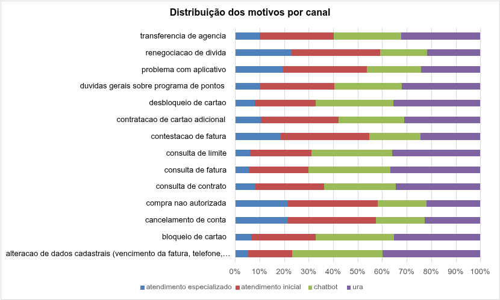

*   **O que mostra:** A proporção de atendimentos de cada motivo distribuída entre os quatro canais (Atendimento Especializado, Atendimento Inicial, Chatbot e URA).
*   **Análise:**
    *   Demandas de baixa complexidade, como consultas (limite, fatura, contrato) e alteração de dados cadastrais, ainda possuem uma presença massiva em canais humanos, somando frequentemente mais de 40% do volume entre o Atendimento Inicial e o Especializado.
    *   O Atendimento Especializado (canal mais caro) absorve uma fatia relevante de demandas simples, como "dúvidas gerais sobre programa de pontos" (cerca de 20%).
    *   Por outro lado, problemas de alta complexidade ou sensíveis, como "compra não autorizada" e "contestação de fatura", apresentam mais de 50% do seu volume concentrado nos canais de automação (Chatbot e URA).
    *   **Insight:** Não existe uma regra clara de roteamento baseada na complexidade. A operação está alocando atendentes humanos caros para responder consultas simples, enquanto tenta resolver problemas complexos e críticos em canais de automação que, muito provavelmente, não têm capacidade de solucioná-los. Isso gera desperdício de verba no N1/N2 e insatisfação/retrabalho no autosserviço.

### Figura 12: Custo Total de Atendimentos por Complexidade e Canal
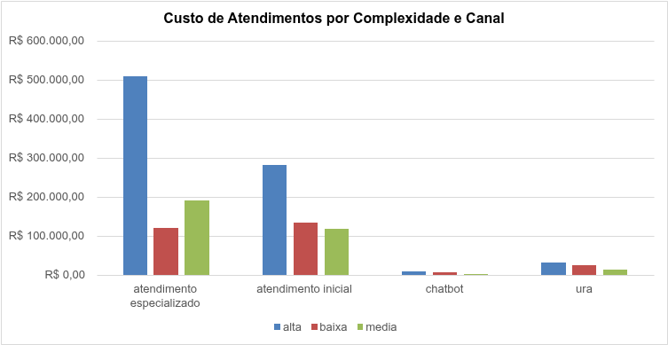

*   **O que mostra:** O custo absoluto total gerado por cada nível de complexidade, segmentado pelos canais de atendimento.
*   **Análise:**
    *   O Atendimento Especializado (N2) concentra o maior custo absoluto da operação, sendo a maior fatia proveniente de chamados de criticidade alta (R$ 500 mil) e média (R$ 190 mil).
    *   O Atendimento Inicial (N1), por sua vez, tem um custo mais equilibrado entre as complexidades, com destaque para a criticidade alta (R$ 280 mil).
    *   **Insight:** O alto custo de complexidade "média" no N2 está diretamente relacionado ao volume de problemas com o aplicativo (que foram classificados como média). Como esse volume cresce, ele infla o custo do canal mais caro. O gráfico comprova que a operação está gastando muito dinheiro para resolver problemas complexos nas camadas mais caras, mas não evidencia se há desperdício na camada de baixa complexidade.

### Figura 13: Custo Médio de Atendimentos por Complexidade e Canal
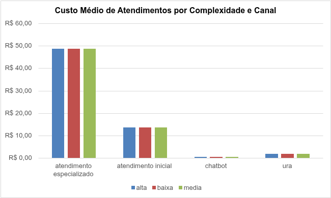

*   **O que mostra:** O custo médio por chamado, segmentado pelo nível de complexidade da demanda e pelo canal de atendimento.
*   **Análise:**
    *   Dentro de um mesmo canal, o custo médio por chamado é praticamente idêntico, independentemente da complexidade ser alta, média ou baixa. O Atendimento Especializado custa cerca de R$ 49,00 para qualquer tipo de problema, enquanto o Atendimento Inicial custa aproximadamente R$ 13,00.
    *   Como o custo está atrelado ao canal e não à complexidade, direcionar um chamado de baixa complexidade (como uma consulta de limite) para o Atendimento Especializado custa quase 4 vezes mais do que se ele fosse resolvido no Atendimento Inicial.
    *   **Insight:** O modelo atual desperdiça recursos ao não segmentar o esforço. A operação deve implementar um roteamento rígido que bloqueie a entrada de demandas de baixa e média complexidade no Atendimento Especializado. O N2 deve ser um canal exclusivo para resolução de problemas de alta complexidade, garantindo o retorno do alto custo por hora desses especialistas.

### Figura 14: Volume de Chamados por Motivo e Recontato
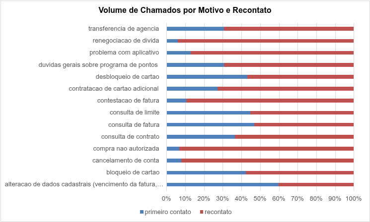

*   **O que mostra:** A proporção de chamados resolvidos no primeiro contato (azul) versus chamados que geraram recontato (vermelho), segmentada por motivo de atendimento.
*   **Análise:**
    *   A recorrência é a regra da operação. Em quase todos os motivos, mais de 80% dos chamados geram recontato.
    *   Apenas "alteração de dados cadastrais" apresenta um índice de resolução no primeiro contato superior a 50%. 
    *   Demandas estruturais (problema com aplicativo, renegociação) e até consultas simples (consulta de fatura, limite) têm taxas de recontato altíssimas (acima de 80%).
    *   **Insight:** A operação falha sistemicamente na resolução no primeiro contato (First Contact Resolution). A altíssima taxa de recontato, mesmo em consultas simples, indica que os canais iniciais não têm autonomia ou ferramentas para fechar o atendimento, forçando o cliente a voltar (e encarecendo a jornada, como visto na Figura 12).

### Figura 15: Volume de Abandonos por Faixa de Tempo de Espera
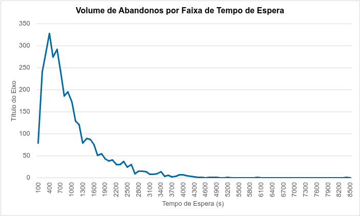

*   **O que mostra:** A distribuição do volume de abandonos de acordo com o tempo (em segundos) que o cliente esperou na fila antes de desistir.
*   **Análise:**
    *   O pico de abandonos ocorre muito cedo, concentrando-se na faixa entre 400 e 700 segundos (aproximadamente 6 a 11 minutos). 
    *   A partir de 15 minutos (900 segundos), o volume de desistências cai drasticamente. A cauda longa do gráfico (acima de 30 minutos) representa uma parcela ínfima de clientes que insistem em esperar.
    *   **Insight:** A operação está falhando em cumprir um SLA básico de espera. O pico de abandono a partir dos 6 minutos indica que a tolerância máxima do cliente é muito curta para os padrões atuais de atendimento digital. Esse tempo correlaciona-se com o ponto onde a nota de satisfação começa a despencar (Figura 06). Qualquer fila superior a 5 minutos está causando evasão em massa, provando que a redução do tempo de espera deve ser a prioridade número um da operação.

### Figura 16: Comparativo da distribuição de chamados e da taxa de abandono por faixa etária
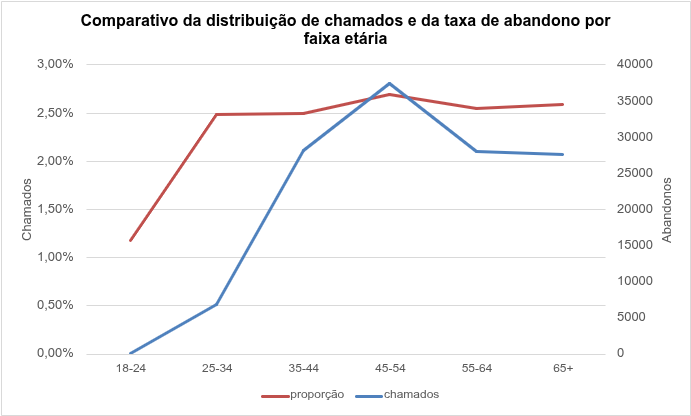

*   **O que mostra:** A relação entre o volume total de chamados e a proporção de abandonos (taxa de abandono) em cada faixa etária.
*   **Análise:**
    *   A taxa de abandono não apresenta uma curva crescente com a idade. O público idoso (65+) tem uma taxa de abandono similar ao público de 25 a 44 anos (cerca de 2,5%).
    *   O único grupo com comportamento divergente é o de 18 a 24 anos, que apresenta uma taxa de abandono quase nula. No entanto, o volume de chamados dessa faixa também é muito baixo.
    *   **Insight:** O abandono não é um problema de acessibilidade restrito a idosos. A taxa de abandono estabiliza-se em um patamar elevado (~2,5%) a partir dos 25 anos, indicando que a experiência de fila é hostil para todo o público adulto. A baixa taxa dos mais jovens provavelmente reflete o menor volume de interações ou uma maior familiaridade com os canais digitais.

### Figura 17: Top 10 Atendentes: Volume vs. Nota e Tempo
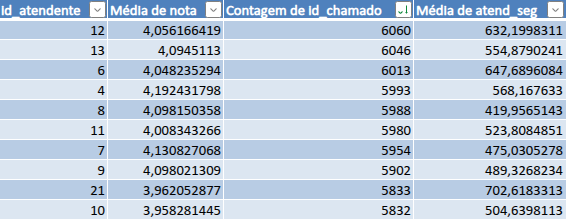

*   **O que mostra:** O volume de chamados, a média de nota e o tempo médio de atendimento dos 10 atendentes com maior demanda.
*   **Análise:**
    *   A distribuição de chamados entre os top 10 atendentes é altamente uniforme, variando de 5.800 a 6.000 chamados para cada um.
    *   A média de nota mantém-se estável em torno de 4,0 para todos, e o tempo médio de atendimento varia entre 7 e 11 minutos, sem correlação direta com a satisfação.
    *   **Insight:** A operação possui uma carga de trabalho bem distribuída e uma equipe com performance homogênea. Não há indícios de sobrecarga individual ou gargalos de treinamento na equipe. Isso reforça que a insatisfação e os altos custos derivam de problemas estruturais (produto e roteamento), e não da capacidade dos atendentes.

### Figura 18: Evolução Mensal da Média de Satisfação
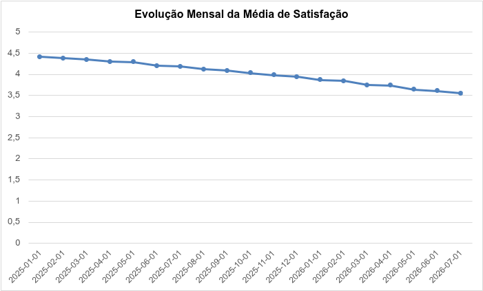

*   **O que mostra:** A evolução da média da nota de satisfação atribuída pelos clientes ao longo dos meses.
*   **Análise:**
    *   A satisfação apresentou uma queda contínua e linear ao longo de todo o período analisado, passando de aproximadamente 4,4 (início de 2025) para 3,5 (julho de 2026).
    *   Não houve nenhum mês de recuperação ou estabilização da nota, indicando que a degradação da experiência é um fenômeno sistêmico e não pontual.
    *   **Insight:** A curva de satisfação corrobora com o diagnóstico geral da operação. A degradação contínua acompanha o aumento exponencial dos problemas com aplicativo e a alta taxa de recontato. A empresa está perdendo a boa vontade do cliente de forma constante e progressiva, o que, a médio prazo, ameaça a retenção e o crescimento da base.